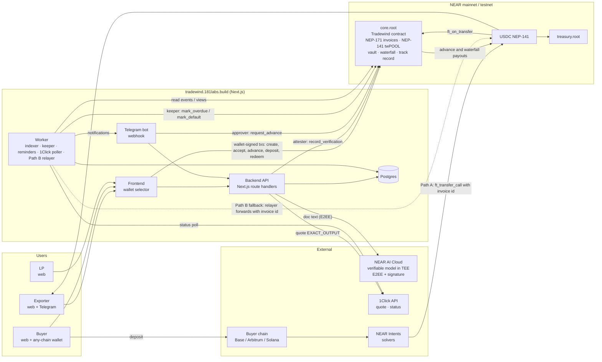

# Tradewind — implementation spec (NEAR HACKATHON)

> Repo copy of the internal spec. Role names are generic: **Dev** = code, deploys, infra; **PM** = spec, README, video, copy; **the owner** = project owner who approves spends, publication and submission.

**Status:** Implemented — see [`CHECKLIST.md`](CHECKLIST.md) for per-feature build status. Decisions D1–D16 use the defaults below as editable config until the owner signs them off.
**Prepared:** Wed 11 Nov 2026, 6:10 PM WAT.
**Supersedes:** `receivable-rail-plan.md` (kept for history).
**Deadline:** repo public with LICENSE and submission sent by **Sun 15 Nov 2026, 00:59 WAT** (2026-11-14T23:59Z). Internal target: **submit by Sat 14 Nov, 22:00 WAT**.
**Hosted demo:** `https://tradewind.181labs.build`, kept up until at least Wed 18 Nov, ideally Wed 25 Nov.
**Tracks:** `realworld` (primary), `defi`, `privacy`. (`nfts` is also a fair fit; see Open question Q7.)

> Product-facing text (README, app, video, X post) names no builders. This doc is internal and uses role names only: **Dev** = code, deploys, infra, repo. **PM** = spec, README, submission, video, copy, promo drafts.

---

## Contents

1. Product summary, pitch, and the "after" vision
2. Users and roles
3. Feature list (numbered, with acceptance criteria)
4. End-to-end flows
5. System architecture (with diagram)
6. Smart contract design
7. Backend and API
8. Data model (off-chain)
9. Frontend screens
10. Telegram bot
11. NEAR AI verification
12. Security and trust assumptions
13. Testnet vs mainnet, and what costs money
14. Demo script (under 3 minutes)
15. Build schedule Wed–Sat, owners, priority order
16. Risks and fallbacks
17. Submission checklist
18. Things needed from the owner
19. Decisions made in this draft (please confirm or change)
20. Open questions
21. Post-hackathon roadmap (months 1–6)
22. Sources

---

## 1. Product summary, pitch, and the "after" vision

**One paragraph.** Tradewind gets exporters paid today on invoices their foreign buyers pay in 60 days. The exporter uploads an invoice; a private AI model running in a NEAR AI Cloud secure enclave (TEE) checks it and returns a signed verdict. The buyer confirms the invoice from their NEAR account, which mints the invoice as an NFT on NEAR. A USDC pool advances 70–85% of the invoice value straight away; the exact rate depends on the buyer's on-chain repayment record. On or before the due date the buyer pays, in one go or in parts, from whatever chain and token they hold, through NEAR Intents. The contract splits each payment in a fixed order: the pool's money plus its fee first, then a small protocol fee, then the rest to the exporter. Each repaid invoice adds to the buyer's record, and the pool's fees raise the value of the LP share token.

**Tagline (from the concept video):** "Get paid today for invoices your buyers pay in 60 days."

**Hackathon pitch (what judges see working):**
- A real invoice-advance loop on NEAR mainnet with small amounts: AI check, buyer acceptance, NFT, advance, cross-chain payment via Intents, split, record update, share price going up.
- Every step is a NEAR transaction anyone can check (explorer links on each receipt).
- Three things that make this more than a demo:
  - The advance rate comes from real on-chain buyer history.
  - LPs hold a share token that earns real fees.
  - Exporters get Telegram notifications and can approve an advance with one tap.

**What it becomes (the "after" vision, shown as a roadmap card):**
- Months 1–2: pilot with 3–5 exporters whose buyers already pay in stablecoins, funded with our own first-loss capital.
- Months 2–6: a licensed lending partner, business checks (KYB) on exporters, buyer checks, payouts through Confidential Intents.
- Month 6: the pool opens to verified outside lenders, and the share token becomes usable as collateral in NEAR DeFi.
- Positioning: invoice finance for the long tail of emerging-market exporters that banks and big factoring firms ignore, with settlement on stablecoin rails.

---

## 2. Users and roles

| Role | Who in the demo | What they can do | Key/account |
|---|---|---|---|
| **Exporter** | "Sample Cashew Exports Ltd" (team test account) | Create invoices, upload documents, link Telegram, opt in to Telegram approvals, request or approve advances, receive the advance and the remainder | Own NEAR account via wallet selector |
| **Buyer** | "Gulf Foods Trading (sample)" (team's second test wallet) | Review the invoice and accept it on-chain; pay in full or in parts from any chain; get reminders | NEAR account (for acceptance) + any-chain wallet (for payment, e.g. Base) |
| **LP (liquidity provider)** | Team account seeding the pool (allowlisted) | Deposit USDC, receive the pool share token (twPOOL), redeem shares for USDC | NEAR account; must be on the LP allowlist in the MVP |
| **Protocol owner / admin** | Team ops account | Set config, pause, manage the LP allowlist, set attester/relayer/approver accounts, refund overpayments, attribute stray payments, freeze or unfreeze buyers | Single owner key in the MVP (multisig is on the roadmap) |
| **Attester** (backend) | `attester.<root>` | Write the AI verification result for an invoice on-chain | Function-call key limited to `record_verification` |
| **Keeper** (backend worker) | `keeper.<root>` | Mark invoices overdue or defaulted (anyone may; we run it so it happens on time) | Function-call key |
| **Approver bot** (Telegram) | `bot.<root>` | Call `request_advance` for an exporter who opted in; the money can only go to that exporter | Function-call key limited to `request_advance` |
| **Settlement relayer** (only in fallback Path B) | `relayer.<root>` | Receive Intents output and forward it into the contract with the invoice id | Full-access key (needed for the 1-yocto deposit on `ft_transfer_call`); kept low-balance |
| **Treasury** | `treasury.<root>` | Receives protocol fees | Plain account |
| **Judge / visitor** | Anyone | Read public receipts, buyer records and pool stats; run the testnet sandbox walkthrough | None needed for read-only; testnet wallet or guided mode for the walkthrough |

`<root>` is the team's mainnet NEAR account for the contract (see §18; it is separate from the owner's payout account).

---

## 3. Feature list

Priority: **P0** = must ship for submission; **P1** = approved addition, ships Fri/Sat; **P2** = last, ships only if earlier items are done (partial-payment UX). The contract supports partial payments from day one because the accounting costs nothing extra. Only the partial-payment UX, Telegram copy and demo segment are P2.

### F1. Wallet connect and exporter onboarding (P0)
- **What:** Connect a NEAR wallet (wallet selector: MyNearWallet, Meteor, HOT). Set a display name and country. The app registers the account for USDC storage if needed.
- **User sees:** "Connect wallet", then the exporter dashboard with an empty state ("Create your first invoice").
- **Acceptance:**
  - A new account can connect on testnet and mainnet.
  - The dashboard loads its invoices from contract views; no data is held only in the browser.
  - If the account isn't registered on USDC, a one-click storage registration runs before the first advance.

### F2. Invoice creation and document upload (P0)
- **What:** The exporter enters the invoice fields: number, buyer name, buyer NEAR account, face value in USDC, issue date, payment terms in days, and goods description. They upload the invoice PDF, plus an optional bill of lading or packing list. The app hashes the documents in the browser (SHA-256). The exporter signs `create_invoice` with a small storage deposit.
- **User sees:** A form with a PDF drop zone (fields auto-fill from the AI extraction in F3), then status **Created → Checking**.
- **Acceptance:**
  - The on-chain invoice stores the face value, tenor, buyer account, document hash and terms hash.
  - The face value must be > 0 and ≤ the configured maximum.
  - The buyer account must not equal the exporter account.
  - Documents are not stored on-chain; only their hashes are.

### F3. Private AI verification via NEAR AI Cloud (TEE) (P0)
- **What:** The backend sends the extracted document text (or page images, for scanned PDFs) to a verifiable model on NEAR AI Cloud with end-to-end encryption. The model returns a JSON verdict (`pass`, `warn` or `fail`) with the extracted fields and the checks it ran. The backend fetches the TEE response signature, verifies it, and the attester account writes the verdict, model id, request and response hashes, signature and signing address on-chain.
- **User sees:** The fields fill in, then a badge "Checked by NEAR AI · private (TEE)", a signature chip (`0x7f3a…c21e`) and "doc hash stored". A **Verify** button re-checks the signature in the browser.
- **Acceptance:**
  - Only models with `verifiable: true` in `GET https://cloud-api.near.ai/v1/model/list` are allowed. The model id is in config; the default is `deepseek/deepseek-v3.2`, with `Qwen/Qwen3-VL-30B-A3B-Instruct` for scanned images.
  - A `provider_tee` signature is fetched and verified before the result is written.
  - If no signature is available after a bounded retry, the verdict is shown as **unverified** and the invoice cannot be advanced.
  - Status becomes **Verified** (pass) or **Rejected** (warn/fail, with reasons shown). Only **Verified** invoices can be advanced.

### F4. Buyer review and on-chain acceptance (P0)
- **What:** The exporter shares a buyer link (`/b/TW-0042`). The buyer sees the invoice terms, the AI verdict and the exact amount and due date. They connect the NEAR account named on the invoice and sign `accept_invoice(invoice_id, terms_hash)`.
- **User sees:** "Gulf Foods Trading (sample) · Invoice TW-0042 · $10.00 · Net 60", then an **Accept invoice** button, then "Accepted · signed by buyer" with a tx link.
- **Acceptance:**
  - Only the named buyer account can accept.
  - The `terms_hash` must match, so the buyer accepts exactly what was created.
  - Acceptance sets `accepted_at` and `due_at = accepted_at + tenor_days × seconds_per_day`.
  - Acceptance mints the NFT (F5).

### F5. Invoice NFT (NEP-171), minted on acceptance (P0)
- **What:** A NEP-171 token with `token_id = "TW-0042"`. Its metadata carries the face value, due date, buyer, document hash, AI attestation reference and live status. It is minted to the exporter. On advance it moves into the pool (held by the contract as collateral). When the invoice is repaid it goes back to the exporter as a paid receipt.
- **User sees:** A token card "Invoice TW-0042 — on-chain asset" with the holder, status and an explorer link.
- **Acceptance:**
  - `nft_token`, `nft_metadata`, `nft_tokens_for_owner` and `nft_total_supply` work (NEP-171 core, metadata and enumeration).
  - A NEP-297 `nft_mint` event is emitted, so explorers show the token.
  - `nft_transfer` by holders is disabled in the MVP (clear error message). Only the contract moves tokens.

### F6. Buyer track record and dynamic advance rate (P1, approved addition)
- **What:** Each buyer account has an on-chain record: invoices accepted, repaid on time, repaid late, defaulted, total repaid volume, and a score. The score sets the advance rate: a new buyer gets 70%, and a good record raises it to at most 85%. Rules are in §6.5.
- **User sees:**
  - On the invoice: "Advance rate 80% · buyer record: 4 repaid (3 on time), score 10".
  - A public buyer page (`/buyer/<account>`) with the history and links to each repaid invoice.
  - After a repayment, the rate visibly rises (e.g. 80% → 83%).
- **Acceptance:**
  - The score changes only from contract events (repaid, late or defaulted). Every point traces to an invoice id.
  - The rate is locked at advance time.
  - The buyer's open exposure is capped by their record (§6.5).
  - Invoices below `min_counted_face`, and self-dealing where exporter = buyer, don't count.

### F7. USDC pool vault with an LP share token (twPOOL) (P0 vault, P1 share token)
- **What:** LPs deposit USDC with `ft_transfer_call(msg={"action":"deposit"})` and receive twPOOL, a NEP-141 share token issued by the same contract. Pool fees raise total assets, so each share is worth more. LPs redeem shares for USDC, up to the idle liquidity.
- **User sees:** A pool page with total assets, idle versus advanced, share price (e.g. 1.0000 → 1.0075), your shares and their value, and Deposit and Redeem buttons. twPOOL shows in the wallet.
- **Acceptance:**
  - Share math as in §6.6, with virtual-share protection against first-depositor inflation.
  - `ft_balance_of`, `ft_total_supply`, `ft_metadata` and `ft_transfer` work for twPOOL, with NEP-297 `ft_mint` and `ft_burn` events.
  - Redeem fails cleanly with "liquidity in advances" when idle USDC is short.
  - Deposits are allowlisted in the MVP; deposits from accounts not on the list are refunded.

### F8. Advance from the pool (P0)
- **What:** For a **Verified + Accepted** invoice, the exporter, or their opted-in approver bot, calls `request_advance`. The contract computes the rate from the buyer's record and checks liquidity and caps. It locks the rate and fees, moves the NFT to the pool, and sends `face × rate` USDC to the exporter.
- **User sees:** "Advance 80% → $8.00 USDC sent to your wallet", a tx link, and the exporter's balance updating. The status becomes **Funded**.
- **Acceptance:**
  - The advance amount, pool fee and protocol fee are stored on the invoice.
  - If the USDC transfer fails, the callback restores the state (status, NFT holder, pool numbers).
  - `expected_terms_hash` and `min_advance` guards stop a stale approval from advancing on worse terms.

### F9. Telegram notifications and the approve-advance card (P1, approved addition)
- **What:** The exporter links Telegram through a deep link (`t.me/<bot>?start=<one-time code>`). The bot sends HTML cards in the FrontDesk style (bold header, emoji-labelled sections, a quoted "Will do" block, inline buttons) for these events: check done, buyer accepted, advance ready (with **Approve advance / Not now / Open invoice**), advance sent, payment received (with the split), repaid, overdue, and defaulted.
- **User sees:** The cards in §10. Tapping **Approve advance** sends the advance (opted-in exporters) or opens the wallet-signing page (not opted in).
- **Acceptance:**
  - Only the linked Telegram user can press buttons.
  - Callback tokens are single-use, expire after 30 minutes, and bind the terms hash and amount. If the terms changed, the card refreshes and asks again (the FrontDesk rule: any change revokes approval).
  - Each approval is logged with the Telegram user id, time and tx hash.
  - If Telegram is not linked, everything still works in the web app.

### F10. Buyer reminders and the late/default path (P0 for the path, P1 for real Telegram delivery)
- **What:**
  - The worker sends buyer reminders at T−7, T−1, due day, T+1 and T+7 (contract days).
  - Delivery is by Telegram if the buyer linked it; otherwise an entry is written to the reminder log.
  - The exporter gets a copy ("Reminder sent to Gulf Foods").
  - The keeper marks **Overdue** after `due_at` and **Defaulted** after `due_at + default_after_days`.
- **User sees:** A reminder log on the invoice; buyer cards with **Pay now** and **Pay part**; on default, a coral "Defaulted" flag on the token and the buyer page, and the pool's written-off amount on the LP page.
- **Acceptance:**
  - Reminders never repeat for the same step.
  - Overdue and defaulted are on-chain status changes with events.
  - A default writes off the pool's unpaid principal (the share price drops honestly) and freezes the buyer (rate 0%).

### F11. Any-chain buyer payment via NEAR Intents 1Click (P0)
- **What:** The pay page (`/pay/TW-0042`) lets the buyer pick a chain and token (Base, Arbitrum, Solana, Ethereum, NEAR). The backend requests a 1Click `EXACT_OUTPUT` quote for the exact USDC-on-NEAR amount. The buyer sends to the deposit address, and the page polls status: PENDING_DEPOSIT → PROCESSING → SUCCESS. The USDC lands in the contract tagged with the invoice id.
  - **Path A (preferred):** 1Click `customRecipientMsg` makes the delivery an `ft_transfer_call` straight into our contract.
  - **Path B (fallback):** the settlement relayer forwards the funds (§6.9).
  - Buyers already on NEAR can pay directly with `ft_transfer_call`.
- **User sees:** A chain ring, then a quote card ("You send 10.03 USDC on Base → contract receives 10.00 USDC on NEAR"), then status steps with the Base tx and NEAR tx links.
- **Acceptance:**
  - The quote uses `swapType: EXACT_OUTPUT`, `destinationAsset: nep141:17208628f84f5d6ad33f0da3bbbeb27ffcb398eac501a31bd6ad2011e36133a1` (USDC on NEAR), `refundTo` set to the buyer's origin address, and a deadline.
  - `dry: true` is used for previews.
  - REFUNDED and FAILED are shown honestly.
  - The amount can't exceed the outstanding balance at quote time.

### F12. Repayment waterfall (P0)
- **What:** Every payment into an invoice is split in this order:
  1. Pool principal, then pool fee, until the pool is whole.
  2. The protocol fee to the treasury.
  3. The rest to the exporter.
  The protocol and exporter parts are pushed with `ft_transfer`. If a push fails (for example, the exporter isn't registered on USDC), the amount is credited as `claimable` and can be collected with `claim()`.
- **User sees:** The split animation on the receipt: Pool $8.15 (principal $8.00 + fee $0.15) · Protocol $0.05 · Exporter $1.80. The token badge flips to **Repaid**.
- **Acceptance:**
  - The amounts match §6.4 to the smallest unit (1e-6 USDC).
  - Events `payment_received` and `waterfall_split` are emitted per payment, and `invoice_repaid` when the invoice is complete.
  - The sum of the parts always equals the payment.

### F13. Partial payments (P2, approved addition, built last)
- **What:** The buyer can pay any amount ≥ `min_payment` and ≤ outstanding, from any chain. Each part runs through the waterfall in order: the pool fills first, then protocol, then exporter. Status is **Partially paid** until the face value is covered.
- **User sees:**
  - On the pay page: "Pay full $10.00" or "Pay part: [amount]".
  - On the invoice: a progress bar (e.g. "$6.00 of $10.00 paid").
  - A payment list with the split per part.
  - A Telegram card per part.
- **Acceptance:**
  - For the worked example in §6.7, both parts produce the exact numbers shown.
  - Overpayment is never sent back to the sender (Intents can't receive refunds). It is held as `overpaid` for an owner refund.
  - The track record only updates when the invoice is fully repaid; on time means the last part arrived by `due_at`.

### F14. Public receipts and proof (P0)
- **What:** A public page per invoice (`/r/TW-0042`) shows:
  - a timeline of every step with its tx hash and explorer link (NearBlocks, Base explorer for the buyer's deposit);
  - the AI verdict with the signature and a **Verify** button;
  - the waterfall per payment.
- **Acceptance:** Every number on the receipt is read from contract views or tx receipts, not typed in.

### F15. LP dashboard (P0 basic, P1 share-price history)
- **What:** Pool totals, share price over time (from events), funded invoices with status, defaults and write-offs, fees earned, and your position.
- **Acceptance:** The share price shown equals `(total_assets + 1) / (total_shares + 1)` from the contract view.

### F16. Demo clock, honest labels, and testnet sandbox (P0)
- **What:**
  - The contract config `seconds_per_day` sets the demo clock: 10 seconds per day on the demo deployments, so 60 days ≈ 10 minutes.
  - A banner says "Demo clock: 1 contract day = 10 seconds".
  - Every sample entity is labelled "(sample)".
  - The app has a network switch: **Testnet sandbox** (default; anyone can run the full loop with faucet test-USDC) and **Mainnet showcase** (real runs, read-only receipts).
- **Acceptance:** The labels in §13.3 appear on screen. No fake numbers are presented as real.

### F17. Judge-ready repo (P0)
- **What:**
  - A README written for AI screeners and humans, with "do X → see Y" steps.
  - An MIT LICENSE.
  - `make test` (contract unit tests plus near-workspaces sandbox tests).
  - `npm run demo:local`, which runs the full loop on a local NEAR sandbox and prints each step.
  - A list of libraries used, a disclosure of reused code, the mainnet contract address and the tx links of the real runs.
- **Acceptance:** A fresh clone on a clean machine runs the tests and the local demo with only documented commands. No secrets are in the repo.

### F18. Admin/ops console (P0, minimal)
- **What:** An owner-only page and CLI: pause/unpause, LP allowlist, config view, attribute or refund unattributed and overpaid funds, unfreeze a buyer, and run the keeper now.
- **Acceptance:** Every admin action is an owner-signed contract call with an event. The page is hidden from non-owners.

**Stretch (only if everything above is done):**
- **S1:** gasless buyer acceptance via a meta-transaction relayer (NEP-366), so the buyer needs no NEAR (a realworld-track hint).
- **S2:** CSV export of invoices and payments for an accountant.
- **S3:** on-chain `ecrecover` check of the TEE signature against an allowlisted signing address.

---

## 4. End-to-end flows

Numbers use the **mainnet demo invoice: face $10.00 USDC, 60-day terms**, buyer rate 80%. The concept video shows the same flow scaled ×1,200: $12,000 face, $9,600 advance, $9,780 / $60 / $2,160 split.

### 4.1 Happy path (single payment)
1. **Create.** The exporter fills the form and drops `TW-0042.pdf`. The browser computes `doc_hash`. The exporter signs `create_invoice{...}` with 0.05 NEAR attached for storage. Status: `Created`.
2. **AI check.** The backend extracts the text and calls `deepseek/deepseek-v3.2` on NEAR AI Cloud (E2EE, non-streaming, canonical model id, `x-no-aliasing: true`). It gets the JSON verdict `pass`, fetches `/v1/signature/{chat_id}?signing_algo=ecdsa`, and verifies the signer against the preflight model attestation. The attester calls `record_verification`. Status: `Verified`. Telegram: "✅ Invoice checked".
3. **Buyer accepts.** The buyer opens `/b/TW-0042`, connects `gulf-foods-sample.near` and signs `accept_invoice("TW-0042", terms_hash)`. The contract mints NFT `TW-0042` to the exporter and sets `due_at`. Status: `Accepted`. Telegram: the "Advance ready" card.
4. **Advance.**
   - The exporter taps **Approve advance** in Telegram (or clicks "Get advance" on the web).
   - `request_advance("TW-0042", terms_hash, min_advance=8_000000)` checks the record: score 10 → 80%, exposure OK, liquidity OK.
   - It locks the terms: advance $8.00, pool fee $0.15, protocol fee $0.05. The NFT moves to the contract and the contract sends `ft_transfer` $8.00 to the exporter.
   - Status: `Funded`. Telegram: "💰 $8.00 sent".
5. **Reminders.** At T−7 and T−1 (contract days) the worker sends the buyer a Telegram card with **Pay now** and **Pay part**. The exporter sees "Reminder sent".
6. **Buyer pays from Base.**
   - The buyer opens `/pay/TW-0042` and picks USDC on Base.
   - The backend requests a 1Click EXACT_OUTPUT quote for 10.000000 USDC on NEAR to `core.<root>` with `customRecipientMsg = {"action":"repay","invoice_id":"TW-0042","payment_ref":"<quote/deposit id>"}` (Path A).
   - The buyer sends ~10.03 USDC on Base to the deposit address. The status goes PENDING_DEPOSIT → PROCESSING → SUCCESS.
7. **Waterfall.**
   - USDC arrives through `ft_on_transfer`.
   - Split: pool $8.15 (principal $8.00 to idle, fee $0.15 to idle), protocol $0.05 to the treasury, exporter $1.80 to the exporter.
   - Status: `Repaid`. The NFT goes back to the exporter as a receipt. Telegram: the "🎉 Repaid" card with the split.
8. **Record and LP.** Repaid on time (≤ `due_at`): +3, so the buyer's score goes 10 → 13 and the next advance rate is 83%. The pool's total assets go $20.00 → $20.15 and the share price goes 1.0000 → 1.0075.

### 4.2 Partial payment (P2)
Same as 4.1 up to step 5. Then:
- **Part 1:** $6.00 from Base via Intents. Waterfall: all $6.00 goes to the pool, as principal. Pool outstanding $2.15. Status `PartiallyPaid`. Share price unchanged, because principal comes back before fees.
- **Part 2:** $4.00 (from Arbitrum via Intents, or from NEAR directly). Waterfall: pool $2.15 (principal $2.00 + fee $0.15), protocol $0.05, exporter $1.80. Status `Repaid`. Share price → 1.0075.

### 4.3 Late and default path (shown with a seeded second invoice, `TW-0043`, 3-day terms)
- After `due_at`, the keeper calls `mark_overdue` → `Overdue`. The buyer gets "Overdue" cards at T+1 and T+7; the exporter gets copies.
- After `due_at + 30` contract days, the keeper calls `mark_default` → `Defaulted`:
  - The pool writes off the unpaid principal and the share price drops.
  - The buyer's score drops by 15 and the buyer is frozen: rate 0%, "Not eligible: default on TW-0043".
- If the buyer later pays, the waterfall still runs: the pool recovers first, and the write-off is reversed for the recovered principal. The record shows "recovered after default", and the buyer stays frozen until the owner unfreezes them.
- Note: the default demo uses a **different sample buyer** ("Northgate Traders (sample)"), so Gulf Foods' record stays clean for the main demo.

### 4.4 LP flow
- **Deposit:** the LP calls `usdc.ft_transfer_call(core, 20_000000, {"action":"deposit"})` and receives 20.000000 twPOOL at a price of 1.0000.
- **Redeem:** the LP calls `redeem(shares)` and gets `shares × price` USDC, up to the idle liquidity.

### 4.5 Rejected check
A `warn` or `fail` verdict sets the status to `Rejected` and shows the reasons (e.g. "Line items sum 11,400 ≠ total 12,000"). The invoice can't be accepted or advanced; the exporter can cancel and re-create it.

---

## 5. System architecture



**Components**

| Component | Tech | Owner | Notes |
|---|---|---|---|
| Contract `core.<root>` | Rust, `near-sdk` 5.x, `near-contract-standards` (NEP-171, NEP-141, NEP-145) | Dev | One contract holds the invoices (NFT), the vault and share token, the waterfall and the track record. One contract means no cross-contract calls between our own parts, so fewer callback bugs (see Decision D1). |
| Mock USDC (testnet only) | Standard NEP-141 with a public `mint` faucet, 6 decimals | Dev | `tusdc.<root>.testnet` |
| Frontend | Next.js (App Router), Tailwind, `@near-wallet-selector`, video palette (navy `#0B1F33`, green `#00C08B`, amber `#F5A524`, off-white `#F6F4EF`, slate `#5B6B7F`, coral `#E5484D`), Inter/Manrope with tabular figures | Dev (copy: PM) | Same look as the concept video |
| Backend API | Next.js route handlers, `near-api-js` for function-call-key signing, `@nearai/inference-sdk` (Node) | Dev | Keys only in env vars / host secret store |
| Worker | Node process (same repo): event indexer, keeper, reminder scheduler, 1Click poller, Path B relayer | Dev | Idempotent jobs; cursor stored in DB |
| Telegram bot | `grammY` (Node), webhook mode, HTML parse mode, inline keyboards | Dev (copy: PM) | Card format copied from the FrontDesk owner card |
| DB | Postgres (or SQLite if simpler on the host) | Dev | Mirror and cache only; the contract is the source of truth for money and status |
| Hosting | Containerised deploy behind a reverse proxy, `tradewind.181labs.build` | Dev | Keep up to 25 Nov. |

---

## 6. Smart contract design

### 6.1 Accounts (mainnet; testnet mirrors with `.testnet`)
- `core.<root>`: the contract.
- `attester.<root>`, `keeper.<root>`, `bot.<root>`: function-call keys on `core` only.
- `relayer.<root>`: only if Path B is used.
- `treasury.<root>`: receives protocol fees.
- Owner: `<root>` itself. A multisig is on the roadmap.
- USDC: `17208628f84f5d6ad33f0da3bbbeb27ffcb398eac501a31bd6ad2011e36133a1` (6 decimals).

### 6.2 Config (owner-settable, all in one struct)
| Field | Demo mainnet value | Production idea | Meaning |
|---|---|---|---|
| `usdc` | USDC contract above | same | Accepted stablecoin |
| `seconds_per_day` | 10 | 86,400 | Demo clock |
| `base_rate_bps` | 7,000 | 7,000 | New-buyer advance rate |
| `max_rate_bps` | 8,500 | 8,500 | Cap |
| `rate_step_bps` | 100 | 100 | Per score point |
| `pool_fee_bps_per_30d` | 75 | market | Pool fee, % of face per started 30 days (60 days → 1.50%) |
| `protocol_fee_bps` | 50 | 50 | % of face, charged only if advanced |
| `grace_days` | 7 | 7 | Late but still +1 |
| `default_after_days` | 30 | 90 | Overdue → default |
| `min_counted_face` | 1 USDC | 1,000 USDC | Below this, no track-record points |
| `min_payment` | 1 USDC | 100 USDC | Smallest partial payment |
| `max_face` | 50 USDC | 250,000 | Safety cap in the demo |
| `base_buyer_limit` | 10 USDC | 10,000 | Exposure for a new buyer |
| `limit_from_volume_bps` | 5,000 | 5,000 | +50% of repaid volume |
| `max_single_advance_bps` | 5,000 | 1,000 | Max share of pool assets in one invoice |
| `invoice_counter_start` | 35 | 1 | So token ids match the sample series TW-0035… (Decision D8) |
| `paused` | false | | Pauses create, accept, advance and deposit; repayments always allowed |

### 6.3 State
```text
owner, treasury, attester, keeper, relayer (Option), config
invoices: LookupMap<InvoiceId, Invoice>
invoices_by_exporter / invoices_by_buyer: LookupMap<AccountId, IterableSet<InvoiceId>>
buyers: LookupMap<AccountId, BuyerRecord>
approvers: LookupMap<AccountId /*exporter*/, AccountId /*approver*/>
lp_allowlist: LookupSet<AccountId>
pool: { idle: u128, outstanding_principal: u128, written_off: u128, fees_earned: u128, protocol_fees_paid: u128 }
shares: FungibleToken (NEP-141, twPOOL, 6 decimals)
nft: NonFungibleToken (NEP-171 + metadata + enumeration)
claimable: LookupMap<AccountId, u128>
unattributed: Vector<StrayPayment{sender, amount, msg, at}>
next_invoice_seq: u64
```

`Invoice`:
```text
id ("TW-0042"), exporter, buyer, buyer_label, invoice_number, face (u128, 6dp), currency ("USDC"),
tenor_days, doc_hash, terms_hash, created_at, accepted_at?, due_at?,
verification?: { verdict, model_id, request_hash, response_hash, signature, signing_address, signing_algo, chat_id, at },
status: Created | Verified | Rejected | Accepted | AdvancePending | Funded | PartiallyPaid | Repaid | Defaulted | Cancelled,
overdue: bool,
advance?: { rate_bps, amount, pool_fee, protocol_fee, at },
paid: { total, to_pool_principal, to_pool_fee, to_protocol, to_exporter, overpaid },
payments: Vec<Payment{amount, at, sender, payment_ref}> (max 20)
```
`Overdue` is a flag, not a dead end: an overdue invoice can still become `PartiallyPaid` or `Repaid`. Which reminders were sent is tracked off-chain by the worker, not in the contract.

`BuyerRecord`: `accepted, repaid_on_time, repaid_grace, repaid_late, defaulted, recovered, repaid_volume, open_principal, score (i32), frozen (bool), last_update`.

### 6.4 Fee and advance math
All integer math in USDC base units. Payouts round down; amounts owed round up.
```text
periods      = ceil(tenor_days / 30)                     # 60 days → 2
rate_bps     = advance_rate(buyer)                        # §6.5
advance      = floor(face × rate_bps / 10_000)
pool_fee     = ceil(face × pool_fee_bps_per_30d × periods / 10_000)
protocol_fee = ceil(face × protocol_fee_bps / 10_000)
pool_due     = advance + pool_fee
exporter_rest= face − pool_due − protocol_fee             # must be ≥ 0; checked in request_advance
```
Worked examples:
| | Face | Rate | Advance | Pool fee | Protocol | Exporter rest |
|---|---|---|---|---|---|---|
| Concept video | $12,000 | 80% | $9,600 | $180 | $60 | $2,160 |
| Mainnet demo | $10.00 | 80% | $8.00 | $0.15 | $0.05 | $1.80 |
| New buyer | $10.00 | 70% | $7.00 | $0.15 | $0.05 | $2.80 |
| Best record | $10.00 | 85% | $8.50 | $0.15 | $0.05 | $1.30 |

- If the invoice was never advanced, a buyer payment goes 100% to the exporter (no protocol fee). The track record still updates.
- The MVP has **no late fee**: fees are fixed at advance time (see Q5).
- Guard: `request_advance` refuses if `exporter_rest < 0`, for example on a very long tenor.

### 6.5 Track record scoring and advance rate
Per buyer, updated by the contract only:
| Event | Score change | Counter |
|---|---|---|
| Fully repaid by `due_at` | **+3** | `repaid_on_time` |
| Fully repaid within `grace_days` after `due_at` | **+1** | `repaid_grace` |
| Fully repaid later than grace (not defaulted) | **−3** | `repaid_late` |
| Marked defaulted | **−15**, `frozen = true` | `defaulted` |
| Repaid after default | 0 (stays frozen until owner unfreezes) | `recovered` |

Only invoices with `face ≥ min_counted_face` and `exporter ≠ buyer` count. Each invoice counts once.

```text
if frozen or score < 0:  rate = 0  (not eligible for advances; invoice can still be paid through Tradewind)
else:                    rate = min(base_rate + min(score, 15) × rate_step, max_rate)
                         → score 0 → 70%, 10 → 80%, 13 → 83%, ≥15 → 85%
```
Exposure caps checked in `request_advance`:
```text
buyer_limit = base_buyer_limit + repaid_volume × limit_from_volume_bps / 10_000
require buyer.open_principal + advance ≤ buyer_limit
require advance ≤ pool.idle
require advance ≤ total_assets × max_single_advance_bps / 10_000
```
Demo record for "Gulf Foods (sample)": 3 on time + 1 grace = score 10 → 80%.
- This comes from real small mainnet invoices run by the team on Saturday morning (TW-0035…0038, about $2 each, repaid directly on NEAR), labelled as team test runs (§13).
- Buyer limit then = $10 + 50% × $8 = $14, which covers the $8 advance.
- After TW-0042 is repaid on time: 13 → 83%.

### 6.6 Share token (twPOOL) math, ERC-4626 style
```text
total_assets = pool.idle + pool.outstanding_principal          # written-off principal excluded
deposit a:   shares = floor(a × (total_shares + 1) / (total_assets + 1))
redeem s:    usdc   = floor(s × (total_assets + 1) / (total_shares + 1)),  require usdc ≤ pool.idle
share_price  = (total_assets + 1) / (total_shares + 1)        # the +1 virtual share/asset blocks inflation attacks
```
- Principal coming back moves `outstanding → idle` (no price change).
- The pool fee adds to `idle` (price rises).
- A default moves the unpaid principal `outstanding → written_off` (price falls). A later recovery moves it `written_off → idle` (price rises back).
- Protocol fees never touch pool assets.
- Example: LP deposits $20 → 20 twPOOL. Advance $8 → idle 12, outstanding 8, total 20, price 1.0000. Repaid → idle 20.15, total 20.15, price ≈ 1.0075.
- The seed invoices on Saturday also pay small pool fees, so the starting price on demo day will be slightly above 1.0000. The video caption uses the real before/after numbers.
- Metadata: name "Tradewind Pool Share", symbol "twPOOL", decimals 6, icon = logo data URI.

### 6.7 Partial-payment accounting (`apply_payment(invoice, p)`)
```text
rem = p
# 1) pool: principal first, then fee
x = min(rem, advance − to_pool_principal);  to_pool_principal += x; move x outstanding→idle (or written_off→idle if defaulted); buyer.open_principal −= x; rem −= x
y = min(rem, pool_fee − to_pool_fee);       to_pool_fee += y; idle += y; fees_earned += y; rem −= y
# 2) protocol
z = min(rem, protocol_fee − to_protocol);   to_protocol += z; push z → treasury; rem −= z
# 3) exporter
w = min(rem, exporter_rest − to_exporter);  to_exporter += w; push w → exporter (or claimable); rem −= w
# 4) excess
overpaid += rem                              # held; owner refunds manually; never returned to sender
total += p
status = Repaid if total − overpaid ≥ face else PartiallyPaid
```
Worked example (face $10, rate 80%):
- Part 1 $6.00 → x=6.00, y=0, z=0, w=0.
- Part 2 $4.00 → x=2.00, y=0.15, z=0.05, w=1.80, rem=0 → Repaid.

Rules: `p ≥ min_payment` unless `p` equals the full outstanding. Payments on `Created`, `Verified`, `Rejected` or `Cancelled` invoices are booked to `unattributed` and not applied.

### 6.8 Methods
**Change methods**
| Method | Caller | Deposit | Effect |
|---|---|---|---|
| `new(owner, treasury, usdc, config)` | deployer | – | init |
| `create_invoice({buyer, buyer_label, invoice_number, face, tenor_days, doc_hash, terms_hash})` | exporter | storage (≈0.05 NEAR, refund extra) | status Created, event `invoice_created` |
| `record_verification(id, {verdict, model_id, request_hash, response_hash, signature, signing_address, signing_algo, chat_id})` | attester | – | Verified / Rejected, event `invoice_verified` |
| `cancel_invoice(id)` | exporter | – | only before Accepted |
| `accept_invoice(id, terms_hash)` | buyer | 1 yocto | Accepted, set `due_at`, mint NFT, `buyer.accepted += 1`, events `invoice_accepted` + `nft_mint` |
| `set_approver(approver: Option<AccountId>)` | exporter | 1 yocto | opt in or out of Telegram approvals |
| `request_advance(id, expected_terms_hash, min_advance)` | exporter or their approver | – | checks → AdvancePending → `ft_transfer` → callback `on_advance_sent` → Funded or revert; events `advance_paid` + `nft_transfer` |
| `ft_on_transfer(sender_id, amount, msg)` | USDC contract only | – | `{"action":"deposit"}` → mint twPOOL (allowlisted, else refund all). `{"action":"repay","invoice_id","payment_ref"}` → `apply_payment`, returns `"0"`. Unknown or bad msg → `unattributed`, returns `"0"`. Never panics on repay-like msgs (see §12) |
| `redeem(shares)` | LP | 1 yocto | burn → `ft_transfer` USDC → callback re-mints on failure |
| `mark_overdue(id)` | anyone | – | if now > due_at and not repaid |
| `mark_default(id)` | anyone | – | if now > due_at + default_after_days × seconds_per_day; write-off; score −15; freeze |
| `claim()` | anyone with claimable | 1 yocto | push claimable USDC |
| Owner: `set_config`, `set_roles(attester, keeper, relayer, treasury)`, `lp_allow(add/remove)`, `pause/unpause`, `unfreeze_buyer`, `attribute_unattributed(index, invoice_id)`, `refund_overpaid(id, to, amount)`, `refund_unattributed(index, to)` | owner | 1 yocto | each emits `admin_action` |

**NEP standard methods:**
- NFT: `nft_token`, `nft_metadata`, `nft_tokens`, `nft_supply_for_owner`, `nft_tokens_for_owner`, `nft_total_supply`. `nft_transfer` and `nft_transfer_call` panic with "Transfers disabled in MVP".
- twPOOL: `ft_transfer`, `ft_transfer_call`, `ft_total_supply`, `ft_balance_of`, `ft_metadata`, `storage_deposit`, `storage_balance_of`.
- **Name clash to handle:** the contract implements `ft_on_transfer` (receiving USDC) and is also a NEP-141 token itself (twPOOL). That is fine, but `ft_on_transfer` must check `predecessor == usdc` and reject anything else.

**View methods:**
- `get_invoice(id)`, `list_invoices(from, limit)`, `invoices_by_exporter(acct)`, `invoices_by_buyer(acct)`.
- `get_buyer_record(acct)`.
- `preview_advance(id)` → `{rate_bps, advance, pool_fee, protocol_fee, exporter_rest, eligible, reason}`.
- `get_pool()` → `{idle, outstanding_principal, written_off, total_assets, total_shares, share_price_e6, fees_earned}`.
- `preview_deposit(a)`, `preview_redeem(s)`, `get_config()`, `get_claimable(acct)`, `list_unattributed()`, `now_contract_day(id)`.

### 6.9 Settlement paths (the open 1Click question)
**Finding (11 Nov, from the 1Click OpenAPI at `https://1click.chaindefuser.com/docs/v0/openapi.yaml`):** the quote request has a field `customRecipientMsg`, marked **"HIGHLY EXPERIMENTAL"**: "Message to pass to `ft_transfer_call` when withdrawing assets to NEAR. Otherwise, `ft_transfer` will be used." Its warning: funds are lost if the token isn't NEP-141, if `storage_deposit` is missing, or if the recipient doesn't implement `ft_on_transfer`. This partly answers the open question: 1Click can, in principle, call our contract with the invoice id.

- **Path A (preferred):**
  - `recipient = core.<root>`, `recipientType = DESTINATION_CHAIN`, `destinationAsset = USDC on NEAR`, `customRecipientMsg = {"action":"repay","invoice_id":"TW-0042","payment_ref":"<id>"}`.
  - Before using it, the contract must be storage-registered on USDC (`storage_deposit` for `core.<root>`).
  - `sender_id` in `ft_on_transfer` will be an Intents account, not the buyer, so `ft_on_transfer` must **never panic and never return unused tokens** on repay messages.
  - No relayer custody.
  - **Thursday test:** one $1 mainnet quote from Base with `customRecipientMsg` into a throwaway test contract that logs the msg. Needs the owner's spend OK; cost ≈ $1 + gas.
- **Path B (fallback if the Thursday test fails or behaves oddly):**
  - `recipient = relayer.<root>`. The worker watches 1Click status for the deposit address.
  - On SUCCESS it reads the delivered amount and calls `usdc.ft_transfer_call(core, amount, {"action":"repay","invoice_id","payment_ref"})`.
  - Labelled "Trusted settlement relayer (MVP)". The relayer keeps a balance near zero, and a reconciliation page lists every forward with both tx hashes.
- **Path C (direct, always available):** a buyer who holds USDC on NEAR pays `ft_transfer_call` from their own wallet on the pay page. No 1Click and no relayer.

### 6.10 Events (NEP-297, `standard: "tradewind"`, `version: "1.0.0"`)
- Invoice lifecycle: `invoice_created`, `invoice_verified`, `invoice_rejected`, `invoice_cancelled`, `invoice_accepted`, `invoice_overdue`, `invoice_defaulted` (written_off), `invoice_repaid` (on_time | grace | late | after_default).
- Advances: `advance_paid`, `advance_reverted`.
- Payments: `payment_received` (amount, sender, payment_ref), `waterfall_split` (to_pool_principal, to_pool_fee, to_protocol, to_exporter, overpaid), `unattributed_payment`.
- Record and pool: `buyer_record_updated` (delta, new score, new rate), `pool_deposit`, `pool_redeem`.
- Admin: `admin_action`.
- Plus the standard `nep171` `nft_mint`/`nft_transfer` and `nep141` `ft_mint`/`ft_burn`/`ft_transfer` events.

### 6.11 Edge cases
| Case | Behaviour |
|---|---|
| Advance `ft_transfer` fails | `on_advance_sent` reverts: status Accepted, NFT back to the exporter, idle and outstanding restored, `advance_reverted` event |
| Exporter not registered on USDC | The advance is blocked before sending (UI runs storage registration first). Waterfall remainder goes to `claimable` |
| Payment before advance | 100% to the exporter, no protocol fee |
| Payment on a Rejected/Cancelled/unknown invoice | Booked to `unattributed`; owner refunds |
| Overpayment / race between two partial payments | Excess goes to `overpaid`, owner refunds |
| Payment after default | Waterfall runs; the pool recovers the write-off first; buyer stays frozen |
| Overdue then paid within grace | +1; overdue flag cleared |
| Due date during pause | Pause doesn't stop the clock, repayments or keeper actions |
| Buyer never accepts | No NFT, no advance; the exporter can cancel |
| Rate changes between card and tap | `min_advance` check fails → revert with "terms changed"; the card refreshes |
| Pool can't cover the advance | `preview_advance.eligible = false`, reason "pool liquidity"; the card shows "Advance not available yet" |
| Reentrancy / double advance | Status `AdvancePending` blocks a second call until the callback resolves |
| u128 overflow | Use checked math / `U256` for intermediate multiplication |
| Storage | Exporter pays on create. The contract keeps a NEAR buffer for NFT mint and its own registrations |
| `ft_on_transfer` called by a token other than USDC | Panic (refunds to that token's sender); only USDC is accepted |

### 6.12 Contract tests (must pass before testnet deploy)
- Unit tests:
  - Fee math table §6.4.
  - Scoring table §6.5.
  - Share math §6.6, including the inflation-attack case.
  - Partial example §6.7.
  - Each edge case in §6.11.
- near-workspaces sandbox test: the full flow with mock USDC (create → verify → accept → advance → 2 partial payments → repaid → record +3 → share price up), plus the default path.

---

## 7. Backend and API

All routes live under `/api`. Responses are JSON. Mutating routes check the wallet session: a NEP-413 signed message proves account ownership and is stored as an httpOnly session.

| Method & path | Who | Purpose |
|---|---|---|
| `POST /api/auth/nonce` · `POST /api/auth/verify` | any | NEP-413 sign-in to tie a web session to a NEAR account |
| `POST /api/invoices/draft` | exporter | Upload PDF(s) (multipart, ≤ 5 MB). Returns `draft_id`, `doc_hash`, extracted fields (from the AI call) for the form prefill |
| `POST /api/invoices/:id/verify` | exporter (after `create_invoice` tx) | Runs/finalises the NEAR AI check for an on-chain invoice id; verifies the signature; attester writes `record_verification`; returns verdict + tx hash |
| `GET /api/invoices/:id` | public | Merged view: contract state + off-chain extras (labels, payment list, reminder log, verification details) |
| `GET /api/invoices?exporter=&buyer=` | public | Lists |
| `POST /api/tx/notify` | any | Frontend posts a tx hash after a wallet-signed call; backend fetches receipts and indexes events right away (the worker also polls) |
| `GET /api/buyers/:account` | public | Track record + history |
| `GET /api/pool` · `GET /api/pool/history` | public | Pool stats; share price series from events |
| `POST /api/pay/:id/quote` | public | Body `{originAsset, amount?, refundTo}`. Caps the amount at outstanding. Calls 1Click `/v0/quote` (`dry:false`, `EXACT_OUTPUT`, `customRecipientMsg` on Path A). Stores a `payment_intent`. Returns deposit address, `amountIn`, `minAmountIn`, deadline |
| `POST /api/pay/:id/quote?dry=1` | public | Preview only (`dry:true`) |
| `POST /api/pay/intents/:pid/deposit-tx` | public | Buyer's origin tx hash → 1Click `/v0/deposit/submit` (speeds up detection) |
| `GET /api/pay/intents/:pid/status` | public | Proxied 1Click `/v0/status` + our settlement status |
| `POST /api/telegram/link` | exporter/buyer | Creates a one-time `start` code (10 min) |
| `POST /api/telegram/webhook` | Telegram | Bot updates, protected by a secret token header |
| `POST /api/telegram/approver` | exporter | Returns the tx args for `set_approver(bot.<root>)` for the wallet to sign |
| `GET /api/verify/:id` | public | Returns raw signature data and hashes so the browser can recheck independently |
| `POST /api/admin/*` | owner session | Run keeper, attribute/refund, unfreeze; each builds a tx for the owner wallet to sign, so the backend holds no owner key |
| `GET /api/health` | public | Liveness + last indexed block + 1Click reachability |

**Worker jobs (every 5 s in demo, 60 s in production):**
1. Index contract events from the RPC (block scan, plus `tx` receipts from `/api/tx/notify`).
2. Poll 1Click status for open payment intents. On Path B, forward on SUCCESS.
3. Keeper: `mark_overdue` and `mark_default` when due.
4. Reminder scheduler (contract-day based).
5. Telegram notifier, outbox pattern with retry.

**Env vars (names only, values in the host's secret store; none in the repo):** `NEAR_NETWORK`, `NEAR_RPC_URL`, `CORE_CONTRACT_ID`, `USDC_CONTRACT_ID`, `ATTESTER_ACCOUNT_ID`, `ATTESTER_PRIVATE_KEY`, `KEEPER_*`, `BOT_*`, `RELAYER_*` (Path B only), `NEARAI_API_KEY`, `NEARAI_MODEL_TEXT`, `NEARAI_MODEL_VISION`, `ONECLICK_BASE_URL`, `ONECLICK_JWT` (optional), `TELEGRAM_BOT_TOKEN`, `TELEGRAM_WEBHOOK_SECRET`, `DATABASE_URL`, `SESSION_SECRET`, `PUBLIC_BASE_URL`.

---

## 8. Data model (off-chain, Postgres)

The contract is the source of truth for status and money. The DB stores what can't or shouldn't be on-chain, plus caches.

| Table | Key columns |
|---|---|
| `accounts` | `near_account` PK, `role_hint`, `display_name`, `country`, `created_at` |
| `invoices_cache` | `id` PK ("TW-0042"), `network`, `exporter`, `buyer`, `face_e6`, `status`, `due_at`, `json_snapshot`, `updated_block` |
| `drafts` | `draft_id`, `exporter`, `doc_hash`, `extracted_json`, `created_at`, `expires_at`. **The PDF itself is deleted right after the AI check** (D5) |
| `verifications` | `invoice_id`, `model_id`, `chat_id`, `request_hash`, `response_hash`, `signature`, `signing_address`, `signing_algo`, `signature_kind`, `attestation_nonce`, `verdict_json`, `verified_ok`, `tx_hash` |
| `payment_intents` | `pid`, `invoice_id`, `origin_asset`, `amount_out_e6`, `amount_in`, `deposit_address`, `deposit_memo`, `refund_to`, `deadline`, `path` (A/B/C), `oneclick_status`, `origin_tx`, `near_tx`, `settled_tx`, `created_at` |
| `payments_cache` | `invoice_id`, `seq`, `amount_e6`, split columns, `sender`, `payment_ref`, `tx_hash`, `block_ts` |
| `buyer_records_cache` | `account`, `score`, `rate_bps`, counters, `updated_block` |
| `pool_snapshots` | `block`, `ts`, `idle`, `outstanding`, `written_off`, `total_shares`, `share_price_e6` |
| `telegram_links` | `near_account`, `tg_user_id`, `tg_chat_id`, `role` (exporter/buyer/lp), `linked_at` |
| `telegram_callbacks` | `token` (random 128-bit), `invoice_id`, `action`, `terms_hash`, `amount_e6`, `tg_user_id`, `expires_at`, `used_at` |
| `notifications_outbox` | `id`, `chat_id`, `kind`, `payload`, `status`, `attempts`, `sent_at` |
| `reminders` | `invoice_id`, `step` (T-7, T-1, D0, T+1, T+7), `channel` (telegram/log), `sent_at`, unique(`invoice_id`,`step`) |
| `audit_log` | `ts`, `actor`, `action`, `invoice_id`, `details`, `tx_hash` |
| `indexer_cursor` | `network`, `last_block` |

---

## 9. Frontend screens

The look follows the concept video: navy background for marketing, off-white cards for app surfaces, green for money in or repaid, amber for pending or due, coral for overdue. A permanent banner reads "Testnet sandbox" or "Mainnet showcase · real funds, tiny amounts", plus "Demo clock: 1 contract day = 10 s".

1. **Landing `/`.** Hook "Shipped today. Paid in 60 days." Tagline, a 3-step explainer, and two buttons: **Try the testnet sandbox** and **See real mainnet runs**. Links to the repo and the video.
2. **Exporter dashboard `/app`.** Cards: Cash due (amber), Cash on hand, Advanced to date. An invoice table (id, buyer, value, status chip, due), a Telegram link status, and **New invoice**.
3. **New invoice `/app/new`.** PDF drop zone, auto-filled fields, the AI check panel (spinner → badge + signature chip), then **Create on-chain** (wallet) and **Copy buyer link**.
4. **Invoice detail `/app/i/TW-0042`.**
   - A timeline (Created → Checked → Accepted → Funded → Paid parts → Repaid).
   - The token card.
   - The advance panel (`preview_advance`: rate, amounts, buyer record, **Get advance**).
   - Payments with their split, the reminder log, and receipts.
5. **Buyer review `/b/TW-0042`.** Invoice summary, AI verdict, terms and due date, **Accept invoice** (wallet), and the Telegram opt-in for reminders.
6. **Pay `/pay/TW-0042`.** Outstanding amount; Full or Part (P2); a chain ring (Base, Arbitrum, Solana, Ethereum, NEAR); the quote card; deposit address with QR and copy; the 3-step status; tx links. The NEAR option uses a direct wallet `ft_transfer_call`.
7. **Pool `/pool`.** Total assets, idle versus advanced, written off, share price with a sparkline, funded-invoices list, your position, and Deposit/Redeem (allowlisted accounts; others see "LP access by invitation during MVP").
8. **Buyer record `/buyer/<account>`.** Score, current rate, a counters table, history rows linking to receipts, and the frozen flag if any.
9. **Receipt `/r/TW-0042`.** Public. Every step with its tx link, the waterfall bars per payment, and the AI proof with a **Verify** button.
10. **Settings `/app/settings`.** Link Telegram, toggle Telegram approvals (`set_approver`), and register on USDC.
11. **Ops `/ops`.** Owner only. Pause, allowlist, keeper run, unattributed/overpaid queue, unfreeze.

Every screen must have empty, loading and error states. Mobile width must work for the buyer and pay pages, because buyers open links from a phone.

**Testnet sandbox guided mode:** on testnet only, a "Play both sides" toggle lets a visitor act as the sample exporter and the sample buyer. Backend-held **testnet** demo keys sign for them, so a judge can run the whole loop without making wallets. This is never available on mainnet.

---

## 10. Telegram bot

- **Bot:** a new bot created with BotFather (name and username the owner's call, e.g. "Tradewind (demo)"). Webhook to `/api/telegram/webhook`, HTML parse mode.
- **Commands:** `/start <code>` (link), `/invoices` (list with status), `/pool` (pool stats), `/stop` (unlink), `/help`.
- **Card style:** copied from the FrontDesk owner card: a bold product name · event type · `code` id header; emoji-labelled sections; a `<blockquote>` stating exactly what a button will do; inline keyboard buttons.

**Exporter: advance ready (the approve card)**
```html
<b>Tradewind</b> · advance ready · <code>TW-0042</code>

<b>🧾 Invoice</b>
$10.00 USDC · Gulf Foods Trading (sample) · Net 60

<b>📈 Advance rate</b>
80% · buyer record: 4 repaid (3 on time) · score 10

<b>💰 You receive now</b>
$8.00 USDC

<b>🧮 If the buyer pays on time</b>
Pool fee $0.15 · protocol fee $0.05 · you get $1.80 more

<blockquote><b>Will do:</b>
Send exactly $8.00 USDC from the Tradewind pool to sample-cashew.near. Terms 9f2c…a71b.</blockquote>
```
Buttons: `✅ Approve advance` · `✋ Not now` · `🔎 Open invoice` (URL).
- Opted in: tap → bot calls `request_advance` as `bot.<root>` → the card is edited to "💸 Sent · tx 4Hk…" with an explorer link.
- Not opted in: the approve button is a URL button to `/app/i/TW-0042?advance=1`, where the wallet signs.
- Terms changed: the card is edited to "Terms changed, review again" with fresh numbers and a new token.
- Not now: the card collapses to "Skipped. Advance stays available in the app."

**Other exporter cards (one line each):**
- ✅ `Checked by NEAR AI (TEE)` · verdict pass · signature 0x7f3a…c21e · [Open]
- ⚠️ `Check failed` · reasons list · [Open]
- 🤝 `Buyer accepted` · Gulf Foods signed TW-0042 · token minted · (followed by the approve card)
- 💸 `Advance sent` · $8.00 · tx link
- 🔔 `Reminder sent to buyer` · T−1 · [Open]
- 💵 `Payment received` · $6.00 of $10.00 via Base · split: pool $6.00 · protocol $0 · you $0 · [Receipt]
- 🎉 `Repaid` · split pool $8.15 · protocol $0.05 · you $1.80 · buyer score 10 → 13 (next rate 83%) · [Receipt]
- 🟠 `Overdue` · TW-0043 is 1 day late · reminders continue
- 🔴 `Defaulted` · TW-0043 · buyer frozen · pool wrote off $X

**Buyer reminder card:**
```html
<b>Tradewind</b> · payment due in 1 day · <code>TW-0042</code>

<b>🧾 Invoice</b>
From Sample Cashew Exports Ltd · $10.00 USDC

<b>💳 Outstanding</b>
$10.00 · due Sat 14 Nov (contract day 60)

<blockquote>Pay from any chain. Exactly the outstanding amount lands in the invoice contract.</blockquote>
```
Buttons: `💳 Pay now` (URL to `/pay/TW-0042`) · `➗ Pay part` (URL to `/pay/TW-0042?part=1`, P2).

**LP (optional):** a 📈 `Share price 1.0000 → 1.0075` card after each repayment.

**Rules:**
- Telegram never moves money on its own except the opted-in `request_advance`, and that can only pay the exporter.
- Buyer payments always need the buyer's wallet.
- No secrets in messages.
- In the demo, one test Telegram account is linked as the exporter and one as the buyer; the owner decides which accounts (§18).

---

## 11. NEAR AI verification

### 11.1 What it checks (JSON schema returned by the model)
```json
{
  "verdict": "pass | warn | fail",
  "extracted": {
    "invoice_number": "", "issue_date": "", "due_date": "", "payment_terms_days": 0,
    "seller_name": "", "buyer_name": "", "currency": "", "subtotal": "", "tax": "", "total": "",
    "line_items": [{"description": "", "qty": "", "unit_price": "", "amount": ""}],
    "goods": "", "incoterm": "", "ports": {"loading": "", "discharge": ""}
  },
  "checks": [
    {"id": "sum_matches_total", "ok": true, "note": ""},
    {"id": "total_matches_form_face", "ok": true, "note": ""},
    {"id": "buyer_matches_form", "ok": true, "note": ""},
    {"id": "terms_consistent_with_dates", "ok": true, "note": ""},
    {"id": "currency_supported", "ok": true, "note": ""},
    {"id": "shipping_doc_consistent", "ok": true, "note": "consignee/goods match invoice (if B/L uploaded)"},
    {"id": "no_obvious_tampering_signals", "ok": true, "note": "e.g. duplicate invoice numbers, totals that don't add up"}
  ],
  "reasons": ["short plain sentences"]
}
```
Verdict rule:
- `pass` only if every check is ok.
- `warn` if only `shipping_doc_consistent` or `no_obvious_tampering_signals` fail.
- Otherwise `fail`.

The backend recomputes the verdict from `checks` and doesn't trust the model's own verdict field. It also recomputes the line-item sum itself, so the arithmetic check doesn't depend on the model.

### 11.2 Prompt (system message)
> You are an invoice checker for a trade-finance service. You receive the text of an invoice and optionally a shipping document, plus the fields the seller typed into a form. Extract the fields and run only the listed checks. Do arithmetic exactly. Do not guess missing values: leave them empty and mark the related check as not ok with a note. Reply with JSON matching the schema and nothing else.

The user message has three parts: `FORM_FIELDS` (JSON), `INVOICE_TEXT`, and optionally `SHIPPING_DOC_TEXT`. `temperature: 0`. Text comes from `pdftotext`; if a page has no text (a scan), its image goes to the vision model instead.

### 11.3 Call and proof flow
1. **Preflight:** request the gateway attestation and the model attestation (`model=<id>`, `provider=near`, client nonce, `signing_algo=ecdsa`); verify them and keep the signing address. The `@nearai/inference-sdk` (`verifyResponse`) does this.
2. **Completion:** call the canonical model id (`deepseek/deepseek-v3.2`) with `x-no-aliasing: true`, non-streaming, `e2ee: true`, `Accept-Encoding: identity`. Keep the exact request and response bytes.
3. **Signature:** `GET https://cloud-api.near.ai/v1/signature/<chat_id>?signing_algo=ecdsa`.
   - Require `signature_kind = provider_tee`.
   - Check that `text == "<model_id>:<sha256(request)>:<sha256(response)>"`.
   - Check that the EIP-191 recovered signer equals the verified model report's `signing_address`.
   - Retry a 404 for up to 20 s.
4. **On-chain:** the attester writes `record_verification` with the verdict, model id, both hashes, signature, signing address, algorithm and chat id.
5. **Public check:** the receipt's **Verify** button fetches `/api/verify/:id` and recomputes the EIP-191 recovery in the browser. It also links to the NEAR AI Verification Center (`cloud.near.ai/verify`).

### 11.4 What is and isn't verifiable (say this plainly in the README)
- **Verifiable:**
  - A specific model running in a TEE signed a response whose bytes hash to `response_hash`, for a request whose bytes hash to `request_hash`.
  - The hashes, verdict and signature are on NEAR and can't be changed later.
  - The document hash on-chain matches the file the exporter holds.
- **Not verifiable on-chain:**
  - That the request contained this exact document. We publish the request bytes' hash, not the document. The exporter can prove it by revealing the document.
  - That the invoice is genuine in the real world. AI checks consistency, not truth.
  - The contract doesn't re-verify the ECDSA signature (stretch S3). It trusts the attester to write what it verified.
- **Privacy:**
  - E2EE means the NEAR AI gateway and host can't read the document.
  - **Our backend does see the document** while checking it, and deletes it afterwards.
  - Face value, buyer account and payments are **public on-chain** in the MVP; confidential amounts are on the roadmap. The privacy-track claim is "documents are checked privately"; we don't claim the deal is private.

---

## 12. Security and trust assumptions (honest list for the README)

1. **Unaudited contract.** Mainnet use is limited to tiny amounts with config caps (`max_face` $50). The owner can pause.
2. **Single owner key.** The owner can change config, roles and the allowlist, and refund overpaid or stray funds. The owner **cannot** take pool funds directly (there is no generic withdraw method). Still, a malicious owner could set a malicious attester or approver, so the owner is trusted in the MVP. Roadmap: multisig via Sputnik DAO or Trezu, plus a timelock.
3. **Attester is trusted to relay the AI result honestly.** Mitigation: the signature and hashes are public and can be checked by anyone.
4. **Approver bot (opt-in).** It can only call `request_advance`, and the money can only go to the invoice's exporter. The worst case is an unwanted advance with fees. Its function-call key is limited to `core` and one method, and the exporter can revoke it with `set_approver(null)`.
5. **Settlement.**
   - Path A relies on an experimental 1Click feature. If storage or `ft_on_transfer` fails, funds can be lost, so we register storage first and never panic in `ft_on_transfer`. Unknown messages go to `unattributed`.
   - Path B adds a **trusted relayer**: it briefly holds buyer funds and could delay or misattribute them. Mitigations: near-zero balance, reconciliation page, every forward logged with the 1Click deposit address and both tx hashes.
   - Either way, anyone can repay an invoice. Paying doesn't need permission, and no one can redirect a waterfall, because the recipients are fixed in the contract.
6. **Buyer acceptance** proves that a NEAR account agreed, not that the account belongs to the real company. KYB is on the roadmap.
7. **Fake invoices and collusion.** Exporter and buyer could collude (two accounts of one person). Guards: `exporter ≠ buyer`, minimum counted face, exposure caps tied to repaid volume, LP allowlist, small caps. These are not proof; real underwriting is on the roadmap. Say so on camera.
8. **Track-record gaming** (wash invoices to raise the score) is limited by the volume-based exposure cap and `min_counted_face`, but not prevented in the MVP.
9. **Keys.** Function-call keys for attester, keeper and bot. A full key only for the Path B relayer, if used. All keys live in the host's secret store, never in the repo or chat. Separate keys for testnet and mainnet. Testnet guided-mode demo keys are testnet only.
10. **Web.** NEP-413 sessions, CSRF protection on mutating routes, Telegram webhook secret, rate limits on `/pay/*/quote` and `/invoices/draft`, PDF size and type checks.
11. **Demo honesty.** The demo clock, sample entities, team-seeded pool and team-run track record are all labelled on screen.

---

## 13. Testnet vs mainnet, and what costs money

### 13.1 Plan
| Stage | Network | What runs |
|---|---|---|
| Thu–Fri dev | Local near-sandbox + **testnet** | Everything except 1Click: contract, mock USDC, AI check (real NEAR AI calls), Telegram, Path C payments |
| Thu | **Mainnet, tiny** (needs OK) | $1 Path A experiment with a throwaway logging contract; 1Click `dry:true` quotes are free |
| Sat AM | **Mainnet** (needs OK) | Deploy `core`, register storage on USDC, seed pool $20, run 4 small seed invoices for the buyer record (direct NEAR repayments, Path C), then the full demo loop with 1Click from Base (1 full + 1 split into 2 parts), then the default path with TW-0043 |
| Judging | Testnet sandbox (interactive) + mainnet showcase (read-only receipts) | Hosted at `tradewind.181labs.build` until 25 Nov |

### 13.2 Costs (mainnet; NEAR ≈ $3.74, the 1Click price on 11 Nov)
| Item | Estimate | Recoverable? |
|---|---|---|
| Contract storage (one wasm with NFT + FT standards ≈ 400–600 KB at ≈ 1 NEAR / 100 KB) | 4–6 NEAR ≈ $15–22 | Yes, if the contract is deleted later |
| Sub-accounts + storage buffers (NFT mints, registrations) | ~1 NEAR ≈ $4 | Mostly |
| Gas for all demo calls | < 1 NEAR ≈ < $4 | No |
| Pool seed (team is the LP) | $20 USDC | Yes (redeem) |
| Seed invoices for the buyer record (4 × $2, paid on NEAR directly) | ~$8 USDC circulating; fees go back to the team | Yes, mostly |
| 1Click payments: test $1 + about $20 of payments from Base | $21 USDC + 0.2% fee (no partner key) ≈ $0.05 + Base gas < $1 | Mostly (the team is both buyer and exporter) |
| Buyer Base wallet top-up (USDC + a little ETH for gas) | ≈ $25, covers the line above | Mostly |
| NEAR AI inference | Covered by the $10 NEAR Builders credit (estimate) | – |
| Telegram, hosting, domain | $0 (existing hosting and domain) | – |
| **Cash needed up front** | **≈ $65–80** | **Most comes back; at risk ≈ $25–35 (storage, gas, fees)** |

Nothing is spent without the owner's explicit OK.

### 13.3 On-screen labels
| Item | Label |
|---|---|
| Pool liquidity | "Demo pool seeded by the team" |
| Exporter and buyer | "Sample Cashew Exports Ltd (sample)", "Gulf Foods Trading (sample) · team test wallet" |
| Buyer history | "Record built from team test invoices on mainnet" |
| Clock | "Demo clock: 1 contract day = 10 seconds" |
| Fees | "Illustrative pricing" |
| Invoice document | "SAMPLE invoice" watermark |
| AI check | "Checked by NEAR AI · private (TEE)" (real) |
| 1Click payment | "Real cross-chain payment" (real) |
| Underwriting/KYB | "Roadmap" |

---

## 14. Demo script (target 2:45, matches the concept video's 10 scenes)

- Recorded on mainnet with real tiny amounts.
- Long waits are cut, with on-screen "+2 min" stamps.
- Silent-friendly: on-screen captions over an instrumental bed. Reuse existing licensed instrumental music.

| # | Time | Video scene | Screen action | Caption |
|---|---|---|---|---|
| 0 | 0:00–0:04 | Logo reveal | Bouncy Tradewind logo | – |
| 1 | 0:04–0:14 | Hook | Ship line Lagos → Dubai, calendar +60 | "Shipped today. Paid in 60 days." / "Payroll can't wait 60 days." |
| 2 | 0:14–0:28 | Dashboard | Exporter dashboard (sample); New invoice; drop PDF | "Upload the invoice." |
| 3 | 0:28–0:45 | NEAR AI check | Fields fill; badge "Checked by NEAR AI · private (TEE)"; click Verify → "Signature valid ✓"; tx link | "Checked privately by AI. Only the verdict and a signature leave the enclave." |
| 4 | 0:45–1:00 | Buyer accepts → TW-0042 | Buyer page on phone; Accept; wallet confirm; token card TW-0042 | "Buyer confirms. The invoice becomes an on-chain asset." |
| 5 | 1:00–1:25 | Pool advance 80% | Telegram approve card on phone: rate 80% from buyer record; tap Approve; card flips to Sent; web shows $8.00 arrived | "Advance rate set by the buyer's on-chain record. Paid today." |
| 6 | 1:25–1:55 | Any-chain via Intents | Pay page; pick Base; quote; pay **part 1 $6** → status steps → SUCCESS; Telegram "Payment received $6 of $10"; then **part 2 $4** (cut) | "Buyer pays from any chain, even in parts. NEAR Intents settles it." |
| 7 | 1:55–2:15 | Waterfall | Receipt: bars split, pool $8.15 · protocol $0.05 · exporter $1.80; token → Repaid | "The contract repays the pool first. The rest goes to the exporter." |
| 7b | 2:15–2:27 | (new) Record + LP | Buyer page score 10 → 13, rate 80% → 83%; pool share price rises (real numbers) | "Every repaid invoice builds the buyer's record. LPs earn the fee." |
| 8 | 2:27–2:38 | Roadmap | Now → Pilot exporters → Licensed partner → Open pool | "Built at NEAR HACKATHON. Then: real exporters, real buyers." |
| 9 | 2:38–2:45 | End card | Logo, tagline, repo + demo URL | "Get paid today for invoices your buyers pay in 60 days." |

- If P2 (partial payments) isn't done, scene 6 uses one full $10 payment and the caption drops "even in parts".
- If time allows, add a 10-second late/default cut after 7b and trim scene 2.
- **Concept video follow-up:** the concept video currently has no Telegram, track-record or share-price beat. Optionally add a 5-second "record + LP" scene to it (PM, Fri).

---

## 15. Build schedule Wed–Sat (WAT), owners, priority order

**Priority order (build in this order; each must work end-to-end on testnet before the next):**
1. Contract core: invoice create, verification record, accept + NFT, vault deposit/redeem, advance, waterfall with partial-capable accounting, track-record scoring, overdue/default, events, tests (F2, F4, F5, F6 logic, F7 vault, F8, F12, F10 path).
2. NEAR AI check + attester (F3).
3. Frontend core screens + wallet (F1, F14, screens 2–7 and 9).
4. 1Click pay page + Path A or B (F11).
5. Track record + dynamic rate in the UI (F6). The contract logic lands in step 1.
6. Share token surface: twPOOL metadata, wallet display, share-price history (F7 token, F15).
7. Telegram bot + approve card + reminders (F9, F10 delivery).
8. Demo clock, labels, testnet sandbox and guided mode, ops page (F16, F18).
9. README, local demo script, LICENSE (F17); written alongside from Thursday.
10. **Partial payments UX, Telegram part cards, demo segment (F13): last.**

| When (WAT) | Dev (code, deploy, infra) | PM (spec, README, video, copy, submission) | Gate |
|---|---|---|---|
| **Wed 11 Nov, evening** | FrontDesk Part B first (due 23:00). No Tradewind code until spec sign-off | Spec review with the owner; apply changes; name decision; prepare sample invoice PDF + B/L (SAMPLE watermark) | **the owner signs off the spec** |
| **Thu 12 Nov, morning–afternoon** | Repo scaffold (private, `dev-salami`); contract step 1 (all of §6) + unit tests + near-workspaces flow; testnet deploy with mock USDC; 1Click `dry:true` quotes; **Path A $1 test (needs OK)** | Nudgeboard first (due 21:00). Then README skeleton with "do X → see Y", labels list, Telegram copy, X post draft | Contract tests green; Path A/B decision by **Thu 22:00** |
| **Thu 12 Nov, night** | NEAR AI check end-to-end on testnet (step 2) | Demo script v2; video shot list | – |
| **Fri 13 Nov** | Frontend screens (step 3); pay page + chosen settlement path (step 4); track record UI (5); twPOOL surface (6); Telegram bot (7); deploy to `tradewind.181labs.build` (DNS + reverse proxy) | Rehearse the full loop on testnet; README steps tested from a clean clone; screenshots; Q-015 disclosure check | Full testnet loop works in the hosted app by **Fri 23:00** |
| **Sat 14 Nov, 08:00–12:00** | Demo clock/labels/sandbox/ops (8); **mainnet deploy (needs OK)**; storage registration; pool seed; 4 seed invoices; local demo script | Collect tx links into README; final copy | Mainnet loop works once |
| **Sat 12:00–15:00** | **Partial payments UX (10)** if 1–9 are done; go/no-go at **14:00** | Record raw demo footage (2 takes) | – |
| **Sat 15:00–18:00** | Fixes only; **code freeze 18:00** | Edit demo video (≤ 3 min) + 1:1 cut; final README; draft X post for the owner; build the submission payload | – |
| **Sat 18:00–22:00** | Keep the hosted demo stable; "make it public" **only after the owner says so in the Dev chat** | the owner posts on X → payload printed for his yes → submit. **Target 22:00** | Repo public + LICENSE; X post live; payload approved |
| **Sun 15 Nov 00:59** | Hard deadline | – | – |

Cut order if behind (cut the first item first): S1–S3 → LP share-price chart → guided mode (keep plain testnet wallets) → buyer-side Telegram (keep the log) → partial-payments UX (keep contract support).

---

## 16. Risks and fallbacks

| Risk | Likelihood | Fallback |
|---|---|---|
| Path A (`customRecipientMsg`) fails, loses the $1, or behaves oddly | Medium | Path B relayer (designed above); label it trusted |
| 1Click minimum swap size above our $4–6 parts | Medium (unknown) | Check with `dry:true` on Thu; raise part sizes (e.g. $20 face, parts $12 + $8) within budget, or do part 2 via Path C |
| NEAR AI signature unavailable or slow | Low–medium | Bounded retry; show "unverified", which blocks the advance; for the demo, re-run. Keep `kimi-k3` as the second verifiable model |
| Contract size makes storage cost higher | Low | Strip enumeration extras; `wasm-opt`; budget has room |
| Wallet-selector issues with `ft_transfer_call` + 1 yocto | Low | Use MyNearWallet for the demo; test Thu |
| Telegram bot blocked or not ready | Low | Show the web notifications panel; Telegram is P1 |
| Schedule collision (FrontDesk Wed, Nudgeboard Thu, Circles) | High | Strict priority order; partial payments last; use the cut order in §15 |
| Mainnet OK or funding comes late on Sat | Medium | Hosted testnet sandbox is fully interactive; the video can use the testnet loop plus a separate mainnet 1Click payment clip |
| Name conflict (Tradewind Finance, export factoring) | Real | Decide Wed (§18). Rename cost: logo, video end card, copy |
| AI screener can't run the project | Medium | `npm run demo:local` on near-sandbox with no keys needed. Mock NEAR AI responses are allowed **only** in the local script, clearly flagged |

---

## 17. Submission checklist

- [ ] Repo `dev-salami/<name>` public (the owner's "make it public" in the Dev chat) before **Sat 14 Nov 23:00 WAT** (buffer before 00:59)
- [ ] `LICENSE` (MIT) at the root
- [ ] README:
  - [ ] what it is, the problem, the "do X → see Y" steps (testnet sandbox + local demo)
  - [ ] the mainnet contract id and tx links of the real runs
  - [ ] the real-vs-simulated table and the trust assumptions (§12)
  - [ ] libraries used, disclosure of reused code (e.g. FrontDesk Telegram card format, the 181 Labs site stack), and AI coding tools
  - [ ] if the owner has a second NEAR project, its name and link (Q-015)
- [ ] No secrets in the repo history (`gitleaks` scan)
- [ ] Hosted demo up at `tradewind.181labs.build`; uptime monitor until 25 Nov
- [ ] Demo video (≤ 3 min) + 1:1 cut, plus the 60–75 s concept video
- [ ] X post by the owner: leads with the user problem; "built at NEAR HACKATHON"; tags **@NEARProtocol #NEARHackathon** (+ optionally @NearLegion @NearBuilders); video attached; repo + demo links; one genuine question
- [ ] Submission payload printed and confirmed by the owner:
  - `requestId` (UUID, generated once and kept)
  - `projectName`, `leadName`, `email`, `size`
  - `tracks: ["realworld","defi","privacy"]` (+`nfts`?)
  - `nearAddress` (the owner's payout account)
  - `projectUrl`, `demoUrl` (the X post)
  - `idea` (20–2000 chars)
  - `consent: true`, only after the verbatim notice is read to him
  - No `website` field
- [ ] POST once to `https://nearhackathon.com/api/applications`; record the 201. Fixes go only through `https://nearhackathon.com/request-changes`

---

## 18. Things needed from the owner

1. **Final name.**
   - "Tradewind Finance" is an established German export-factoring firm, i.e. the same business we are in. That is a real conflict for anything beyond the hackathon.
   - No "Tradewind" entry was found among the hackathon submissions (search on 11 Nov, ~18:10 WAT).
   - Options:
     - (a) Keep "Tradewind" for the hackathon and rename before any pilot or commercial use.
     - (b) Rename now, before the logo, video end card and repo name are final. If (b), the PM will run name checks first.
2. **Spec sign-off:** this document, including the decisions in §19.
3. **Mainnet payout NEAR account:** he creates it himself in his own wallet and shares only the account id.
4. **Mainnet contract root account:** OK to create `<root>` (a team account for the contract), or tell us which existing account to use.
5. **Spend OK:** ≈ $65–80 up front (≈ $25–35 at risk), plus the $1 Path A test on Thursday.
6. **NEAR AI API key:** claim the $10 NEAR Builders credit (https://nearbuilders.org/dashboard) or buy credits at https://cloud.near.ai. The key goes straight into server secrets, never into chat.
7. **Telegram:** create the bot with BotFather, or approve that one be created; the token goes straight into server secrets. Also say which Telegram accounts play exporter and buyer in the demo.
8. **Base buyer wallet funding:** which wallet plays the buyer, and the OK to top it up (≈ $25 USDC + a little ETH).
9. **"Make it public"** for the repo, said in the Dev chat.
10. **The X post:** he posts it himself (we draft) and sends us the link.
11. **Submission payload:** approve the exact JSON (lead name, contact email, team size, tracks).
12. **2-project limit:** confirm whether Tradewind is his only NEAR HACKATHON project. If there is a second, both READMEs must name each other.

---

## 19. Decisions made in this draft (confirm or change)

| # | Decision | Why |
|---|---|---|
| D1 | **One contract** holds the invoice NFT (NEP-171), the vault and twPOOL share token (NEP-141), the waterfall and the track record | No internal cross-contract calls means fewer callback bugs in 3 days. Splitting it is on the roadmap |
| D2 | **Pool fee = 0.75% of face per started 30 days** (60 days → 1.5%); **protocol fee 0.5% of face**, only on advanced invoices | Reproduces the video's numbers exactly ($180 / $60 on $12,000) |
| D3 | **Scoring:** on time +3, grace +1, late −3, default −15 and freeze; rate = 70% + 1% per point, capped at 85%; score < 0 or frozen → 0% | Simple to explain; 3 on time + 1 grace = 80%, as in the video |
| D4 | **Principal is repaid before fee** within the pool tranche | Conservative; the share price only rises once the principal is safe |
| D5 | **Invoice PDFs are deleted after the AI check**; only the hash and verdict are kept | Privacy-track honesty; less data to protect |
| D6 | **NFT minted on buyer acceptance**, to the exporter; moved to the pool on advance; returned as a receipt when repaid; holder transfers disabled | Matches the video ("buyer confirms → on-chain asset"); avoids building a secondary market |
| D7 | **Telegram approve** works through an exporter-opted-in approver account (`set_approver`) that can only call `request_advance`, paying only the exporter | One-tap approval without the bot holding the exporter's keys; fits the security story |
| D8 | Token ids start at **TW-0035**, so the seed invoices are TW-0035…0041 and the demo invoice is **TW-0042**, matching the video | Continuity with the concept video; all ids belong to real on-chain invoices |
| D9 | **Demo clock 10 s per contract day** on the demo deployments | 60-day terms ≈ 10 minutes, which leaves time for real 1Click payments before the due date |
| D10 | **LP deposits allowlisted**; external LPs stay on the roadmap | No pooled-investment exposure in the MVP |
| D11 | **Overpayments are held, not returned** to the sender | The Intents sender can't receive refunds; the owner refunds manually |
| D12 | **Default model `deepseek/deepseek-v3.2`**, vision fallback `Qwen/Qwen3-VL-30B-A3B-Instruct`, backup `moonshotai/kimi-k3`; all are `verifiable: true` in the model list on 11 Nov | TEE-backed privacy claim |
| D13 | **Hosted app defaults to the testnet sandbox** (with a guided "play both sides" mode); mainnet runs are shown as read-only receipts | Judges can try the full loop without spending real money |
| D14 | Share token symbol **twPOOL** ("Tradewind Pool Share") | Avoids looking like a wrapped USDC |
| D15 | **No late fee in the MVP** | Keeps the waterfall math simple; on the roadmap |
| D16 | **Settlement Path A first** (1Click `customRecipientMsg` → our `ft_on_transfer`), Path B relayer as fallback, Path C direct NEAR pay always on | Removes the trusted relayer if the Thursday test passes |

---

## 20. Open questions

1. **Q1 (Thu): Path A vs Path B.** Does 1Click's experimental `customRecipientMsg` deliver into our `ft_on_transfer` reliably on mainnet? (A $1 test needs the spend OK.)
2. **Q2:** What is the 1Click minimum amount per swap for USDC Base → USDC NEAR? Does it allow our $4–6 partial payments?
3. **Q3:** Name, per §18.1.
4. **Q4:** Should buyer acceptance be gasless (stretch S1, meta-transaction relayer), or is it fine for the demo buyer to hold a little NEAR?
5. **Q5:** Should overdue invoices accrue an extra pool fee (late fee)? The draft says no for the MVP.
6. **Q6:** Will the NEAR AI $10 credit cover dev + demo calls? Probably, since the documents are small, but there is no measured number yet.
7. **Q7:** Add the `nfts` track too? The invoice NFT holds repayment state but doesn't own funds itself (the contract does), so the fit is fair but not strong.
8. **Q8:** Repo name: `tradewind` (or the final name) under `dev-salami`?
9. **Q9:** Should buyers get reminders by email too? Out of scope for now; Telegram + log only.
10. **Q10:** Postgres or SQLite on the host (Dev's call)?

---

## 21. Post-hackathon roadmap (months 1–6)

| Month | Product | Market / licensing |
|---|---|---|
| 1 | Audit-lite review and fuzz tests; split contracts (registry / vault); multisig owner (Sputnik DAO or Trezu) + timelock; promote Path A or build trust-minimised settlement; email reminders; late fees; CSV export | Interview 15–20 exporters and agencies whose buyers already pay in stablecoins; apply to NEAR ecosystem programmes |
| 2 | Pilot with 3–5 exporters on our own first-loss capital, small tickets; buyer onboarding pack | Legal counsel on structure; approach a CBN-licensed finance company as lending partner |
| 3 | KYB for exporters, buyer verification, document-provenance checks (e-invoice / customs data where available); on-chain verification of TEE signatures | Assess the SEC route (pooled LP product, VASP rules under the Investments and Securities Act 2025) |
| 4 | Confidential Intents payouts and private amounts; LP risk dashboard; disputes flow | Credit insurance / guarantee partner talks; track the Factoring and Receivables Financing Bill |
| 5 | Buyer fiat on-ramp partner (buyers who pay by wire); exporter off-ramp to local currency | Apply to the NDIFS pilot if it is open to fintechs (unknown) |
| 6 | Open the pool to verified outside LPs if licensing allows; multi-invoice pools / tranches; twPOOL as collateral in NEAR DeFi (e.g. Rhea lending); tradable invoice NFTs | Decide on our own finance-company licence vs the partner model |

Still out of the MVP (roadmap only): KYC/KYB, fiat ramps, external LPs, disputes, private payouts / Confidential Intents, multi-invoice pools, share token as collateral.

---

## 22. Sources

- Rules: `HACKATHON.md` (internal) (live: https://nearhackathon.com/HACKATHON.md). Re-read before submitting.
- Track prompts: `04-business.md` (internal), `06-security.md`, `07-agents.md`, `08-realworld.md`, `12-social.md`.
- Previous plan: `receivable-rail-plan.md` (internal) (superseded).
- Concept video: `video-brief.md` (internal), (internal).
  - Numbers used: $12,000 face, 80% → $9,600, split $9,780 / $60 / $2,160.
  - Ids: TW-0042, TW-0039, TW-0035.
  - Tagline: "Get paid today for invoices your buyers pay in 60 days."
- 1Click OpenAPI (quote fields incl. `customRecipientMsg`, `EXACT_OUTPUT`, statuses): https://1click.chaindefuser.com/docs/v0/openapi.yaml.
- 1Click token list: https://1click.chaindefuser.com/v0/tokens (checked 11 Nov ~18:08 WAT; all 6 decimals):
  - USDC NEAR `nep141:17208628f84f5d6ad33f0da3bbbeb27ffcb398eac501a31bd6ad2011e36133a1`
  - Base `nep141:base-0x833589fcd6edb6e08f4c7c32d4f71b54bda02913.omft.near`
  - Arbitrum `nep141:arb-0xaf88d065e77c8cc2239327c5edb3a432268e5831.omft.near`
  - Solana `nep141:sol-5ce3bf3a31af18be40ba30f721101b4341690186.omft.near`
- NEAR AI Cloud response signatures: https://docs.near.ai/cloud/verification/cloud-api/response-signatures.md.
- JS SDK `@nearai/inference-sdk`: https://docs.near.ai/cloud/inference-sdk/javascript.md.
- Model list (verifiable flags): https://cloud-api.near.ai/v1/model/list (checked 11 Nov ~18:08 WAT).
- FrontDesk Telegram card format: (internal reference, not in repo).
- NEAR standards: NEP-171 (https://github.com/near/NEPs/blob/master/neps/nep-0171.md), NEP-141 (https://github.com/near/NEPs/blob/master/neps/nep-0141.md). NEP-297 events, NEP-413 signed messages and NEP-366 meta transactions are at https://github.com/near/NEPs.
